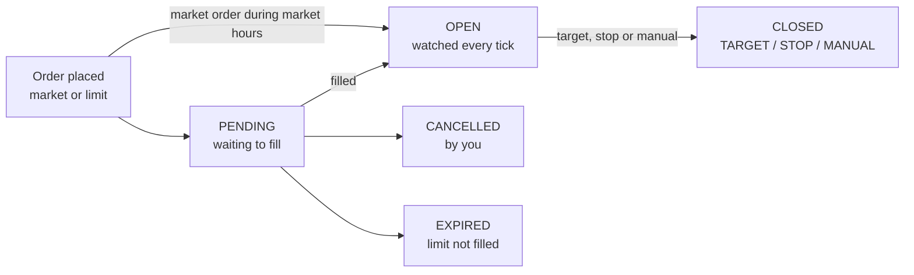
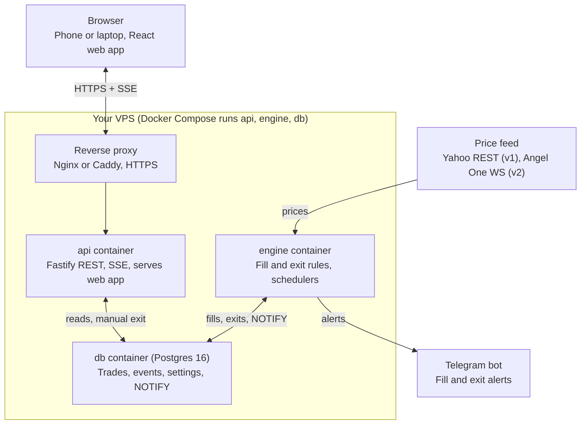

# Paper Trading Simulator — PRD

Oct 31, 2026 · @Manovignesh

## Overview

A self-hosted paper trading app for NSE swing trades: you buy at the live price with a target and a stop-loss, and the server exits the trade automatically when either is hit. No real money, no real orders.

**Problem.** Swing trade ideas are hard to judge from memory. Without a record of entry, target, stop and outcome, there is no honest measure of whether predictions work.

**Goal.** Practise swing trading with realistic fills and an automatic journal, then use the stats to decide whether a strategy is worth real money.

### Success criteria

- **REQ-SUCCESS-001** Every open trade is checked against live prices for the whole session (9:15–15:30 IST, trading days only).
- **REQ-SUCCESS-002** A target or stop-loss hit closes the trade within 5 seconds with a live feed, or within one poll interval with a polled feed.
- **REQ-SUCCESS-003** After 30 trades, the stats page shows win rate, average win vs average loss, expectancy and max drawdown without manual work.
- **REQ-SUCCESS-004** Restarting the server or VPS loses no trades and misses no exits that happened while it was down (they are reconciled on start).

**User.** A single trader (you), running it on your own VPS. Multi-user is a later option, not v1.

v1 is long-only NSE equity delivery trades with one entry, one target and one stop per trade.

## Scope

| Area | v1 (in scope) | Later | Out of scope |
| --- | --- | --- | --- |
| Instruments | NSE cash equities | BSE, indices as watch-only | F&O, commodities, currency |
| Direction | Long (buy first) | Short (sell first) | — |
| Entry | Market price at order time; limit entry that waits for a price | Scale-in (multiple entries) | — |
| Exit | Target, stop-loss, manual exit | Trailing stop, partial exits, time-based exit | — |
| Prices | Yahoo Finance (delayed, free) | Angel One SmartAPI WebSocket (live, free) | Paid feeds (Kite Connect) |
| Users | Single user, password login | Multi-user | Social or sharing features |
| Charges | Configurable brokerage, STT and fees per trade | Exact per-broker charge tables | — |
| Alerts | Telegram message on entry and exit | Web push | SMS |
| Real trading | None | — | Placing real orders with any broker |

## Functional requirements

Sixteen requirements in five groups cover v1; IDs are used in tickets and commits.

### Virtual account

- **REQ-ACCOUNT-001** **FR-1** Starting capital is configurable (default ₹1,00,000). Reset clears all trades and restores capital, after a confirm step.
- **REQ-ACCOUNT-002** **FR-2** Cash = capital − money locked in open trades + realised P&L − charges. Buying is blocked if cash is short.
- **REQ-ACCOUNT-003** **FR-3** Dashboard shows cash, invested value, current value, unrealised P&L, realised P&L, and total equity.

### Placing a trade

- **REQ-ORDER-001** **FR-4** Symbol search over the NSE instrument list (e.g. RELIANCE, SBIN), showing the latest price.
- **REQ-ORDER-002** **FR-5** Order form fields: symbol, quantity (or ₹ amount, converted to whole shares), entry type (market or limit), target price, stop-loss price, notes (thesis, setup tag such as breakout or pullback).
- **REQ-ORDER-003** **FR-6** Validation: stop < entry < target; quantity ≥ 1; target and stop within ±50% of entry (guards against typos). The form shows risk (₹ and %), reward (₹ and %) and the risk:reward ratio before submit.
- **REQ-ORDER-004** **FR-7** Market order outside market hours is queued and fills at the next session's first price (see Auto-exit engine).
- **REQ-ORDER-005** **FR-8** Limit entry stays pending until the price trades at or below the limit; it can be cancelled, and expires after a configurable number of days (default 5).

### Managing open trades

- **REQ-TRADE-001** **FR-9** Open positions table: symbol, qty, entry, LTP, target, stop, unrealised P&L (₹ and %), distance to target and stop (%), last price time.
- **REQ-TRADE-002** **FR-10** Edit target and stop on an open trade. Every change is kept in the trade's event log.
- **REQ-TRADE-003** **FR-11** Manual exit at the current price.

### Journal and stats

- **REQ-JOURNAL-001** **FR-12** Closed trades list with filters (date range, symbol, setup tag, exit reason) and CSV export.
- **REQ-JOURNAL-002** **FR-13** Trade detail page: all events (created, filled, modified, exited) with timestamps and prices, plus your notes and a post-trade review field.
- **REQ-JOURNAL-003** **FR-14** Stats: total trades, win rate, average win, average loss, expectancy per trade, profit factor, average R-multiple, average holding days, max drawdown, best and worst trade, and the same split by setup tag.
- **REQ-JOURNAL-004** **FR-15** Equity curve chart (daily total equity).

### Notifications

- **REQ-NOTIFY-001** **FR-16** Telegram bot message on fill, target hit, stop hit, and manual exit (symbol, price, P&L). Bot token and chat ID come from environment variables; off if not set.

## Auto-exit engine

The engine is a separate worker process that checks every open trade on every price update and closes it in one database transaction when the target or stop is crossed.

### Trade states

**Every trade ends CLOSED, CANCELLED or EXPIRED.**



*Trade states · 6 states, 2 terminal paths from PENDING.*

A market order during hours skips PENDING and opens immediately; only OPEN trades are watched for target and stop.

### Entry fill rules

1. **REQ-ENTRY-001** Market order during market hours fills at the current LTP, plus optional slippage (default 0.05%).
2. **REQ-ENTRY-002** Market order outside hours becomes PENDING and fills at the first price of the next session.
3. **REQ-ENTRY-003** Limit entry fills when LTP ≤ limit, at the limit price. If the session opens below the limit, it fills at the open price.

### Exit trigger rules

1. **REQ-EXIT-001** On each price update for an OPEN trade: LTP ≥ target → exit with reason TARGET; LTP ≤ stop → exit with reason STOP.
2. **REQ-EXIT-002** Normal crossing during the session fills at the target or stop level, minus slippage on stops.
3. **REQ-EXIT-003** **Gap at session open:** if the first price of the day is already beyond a level, the fill is at that opening price. A gap down through the stop is a bigger loss; a gap up over the target is a bigger win. This mirrors real trading and keeps results honest.
4. **REQ-EXIT-004** If target and stop are both crossed within the same candle (possible with polled data), assume the stop hit first.
5. **REQ-EXIT-005** The exit runs inside a transaction that locks the trade row (`SELECT … FOR UPDATE`) and re-checks `status = 'OPEN'`, so an auto exit and a manual exit can never both apply.

### Market hours

- **REQ-HOURS-001** Active 09:15–15:30 IST, Monday to Friday, except NSE holidays (kept in a `market_holidays` table, updated yearly).
- **REQ-HOURS-002** Pre-open (09:00–09:15) prices are ignored; the first price after 09:15 counts as the session open.
- **REQ-HOURS-003** Outside hours the engine idles; pending market orders wait for the next open.

### Recovery after downtime

On start, and after any feed outage longer than 60 seconds, the engine fetches 1-minute candles from the last checked time for each open or pending trade. It walks the candles in order and applies the same rules (using candle high and low), so an exit that happened while the server was down is booked at the right time and price.

## Market data

Prices come through one `PriceProvider` interface, so v1 ships on free Yahoo data and v2 switches to Angel One's live feed with a config change (`PRICE_PROVIDER=yahoo | angelone`).

### Provider interface

```typescript
interface PriceProvider {
  name: string;
  start(): Promise<void>;
  stop(): Promise<void>;
  subscribe(symbols: string[]): Promise<void>;
  unsubscribe(symbols: string[]): Promise<void>;
  onTick(cb: (tick: { symbol: string; ltp: number; ts: Date }) => void): void;
  getQuote(symbol: string): Promise<{ ltp: number; ts: Date }>;
  getCandles(symbol: string, from: Date, to: Date, interval: '1m' | '1d'): Promise<Candle[]>;
  searchInstruments(query: string): Promise<Instrument[]>;
}
```

The engine subscribes only to symbols with OPEN or PENDING trades, plus anything on screen in the dashboard.

### Providers

| Provider | Version | How prices arrive | Delay | Cost | Notes |
| --- | --- | --- | --- | --- | --- |
| Yahoo Finance (unofficial) | v1 | REST polling, `RELIANCE.NS` style symbols | Delayed, can be minutes | Free, no account | Unofficial endpoints can change or rate-limit without notice; poll every 15–30 s, batch symbols, back off on errors |
| Angel One SmartAPI | v2 | WebSocket V2, LTP mode | Real-time | Free for Angel One clients | Needs an Angel One account, API key, client code, PIN and TOTP secret; session expires daily, so the worker logs in again each morning before 09:15 |
| Kite Connect (Zerodha) | Not planned | WebSocket | Real-time | ₹500/month per app for market data | Free Personal plan has no market data |

### Feed health

- **REQ-FEED-001** Each tick updates `last_tick_at` per symbol. No tick for 60 s during market hours marks the feed STALE: shown as a warning on the dashboard and sent once to Telegram.
- **REQ-FEED-002** While STALE, no exits are booked from old prices. When the feed returns, recovery (previous section) replays the gap from candles.
- **REQ-FEED-003** Prices are kept in memory for the engine; only 1-minute bars for symbols with trades are stored (for charts and audits).

## Architecture & deployment

Three containers on your VPS: an API that also serves the web app, an engine worker that watches prices and books fills and exits, and Postgres. Postgres is the only shared state; live updates reach the browser through Postgres LISTEN/NOTIFY and Server-Sent Events, so no Redis is needed.

**The engine is the only process that books fills and exits.**



*System architecture · 3 containers on the VPS.*

Prices flow into the engine only; the API learns about fills and exits from Postgres and pushes them to the browser.

### Stack

| Layer | Choice | Why |
| --- | --- | --- |
| Language | Node.js 22 LTS + TypeScript | One language for API, engine and UI |
| API | Fastify, Zod for validation | Fast, schema-first, simple |
| Database | PostgreSQL 16, Drizzle ORM + SQL migrations | Typed queries, plain SQL migrations |
| Web app | React + Vite, built to static files served by the API | One container, mobile-friendly UI |
| Live UI updates | Server-Sent Events | One-way price and trade updates, simpler than WebSockets |
| Scheduling | node-cron in the engine (IST) | Morning login, session open/close, limit expiry |
| Logs | pino (JSON) to stdout | `docker compose logs` works out of the box |
| HTTPS | Your existing reverse proxy (Nginx or Caddy) in front of the API | Reuse what the VPS already runs |

### Rules

- **REQ-ARCH-001** Only one engine may run: it takes a Postgres advisory lock at start and exits if the lock is held.
- **REQ-ARCH-002** The engine never reads from the API; the API never books fills or exits (except manual exit, which uses the same locked transaction).
- **REQ-ARCH-003** All times are stored as `timestamptz` in UTC and shown in IST.
- **REQ-ARCH-004** Secrets (DB password, Angel One keys, Telegram token, app password hash) live in `.env`, never in the repo.

### docker-compose.yml (outline)

```yaml
services:
  db:
    image: postgres:16-alpine
    environment:
      POSTGRES_DB: papertrade
      POSTGRES_USER: papertrade
      POSTGRES_PASSWORD: ${DB_PASSWORD}
    volumes:
      - pgdata:/var/lib/postgresql/data
    healthcheck:
      test: ["CMD-SHELL", "pg_isready -U papertrade"]
      interval: 10s
    restart: unless-stopped

  api:
    build: { context: ., dockerfile: apps/api/Dockerfile }
    env_file: .env
    depends_on:
      db: { condition: service_healthy }
    ports:
      - "127.0.0.1:3000:3000" # reverse proxy in front
    restart: unless-stopped

  engine:
    build: { context: ., dockerfile: apps/engine/Dockerfile }
    env_file: .env
    environment:
      TZ: Asia/Kolkata
    depends_on:
      db: { condition: service_healthy }
    restart: unless-stopped

volumes:
  pgdata:
```

### Repository layout

```text
paper-trade/
  apps/
    api/        Fastify routes, SSE, serves web build
    engine/     price providers, fill/exit rules, schedulers
    web/        React + Vite UI
  packages/
    core/       shared types, trade rules (pure functions), charges
    db/         Drizzle schema + migrations
  docker-compose.yml
  .env.example
```

The fill and exit rules live in `packages/core` as pure functions (price in, decision out), so they are unit-tested without a database or a feed.

## Data model

Six tables. Money and prices use `numeric`, never floating point. Cash and P&L are derived from trades, not stored separately, so they can never drift.

| Table | Holds | Key columns |
| --- | --- | --- |
| `account` | One row: settings for the virtual account | `starting_capital`, `slippage_bps`, `charges` (jsonb), `limit_validity_days`, `reset_at` |
| `instruments` | NSE symbol list, refreshed daily | `symbol`, `name`, `exchange`, `yahoo_symbol`, `angel_token`, `tick_size` |
| `trades` | One row per trade | entry, target, stop, fill and exit fields, `status`, `exit_reason`, notes |
| `trade_events` | Append-only history of each trade | `type`, `price`, `payload`, `created_at` |
| `market_holidays` | NSE trading holidays | `date`, `description` |
| `price_bars_1m` | 1-minute bars for symbols with trades | `symbol`, `ts`, `open`, `high`, `low`, `close` |

```sql
CREATE TYPE trade_status AS ENUM
  ('PENDING', 'OPEN', 'CLOSED', 'CANCELLED', 'EXPIRED');
CREATE TYPE exit_reason AS ENUM ('TARGET', 'STOP', 'MANUAL');
CREATE TYPE entry_type AS ENUM ('MARKET', 'LIMIT');

CREATE TABLE trades (
  id bigserial PRIMARY KEY,
  symbol text NOT NULL REFERENCES instruments(symbol),
  qty integer NOT NULL CHECK (qty > 0),
  entry_type entry_type NOT NULL,
  limit_price numeric(12,2),               -- LIMIT only
  target_price numeric(12,2) NOT NULL,
  stop_price numeric(12,2) NOT NULL,
  status trade_status NOT NULL DEFAULT 'PENDING',
  entry_price numeric(12,2),               -- set on fill
  entry_at timestamptz,
  exit_price numeric(12,2),
  exit_at timestamptz,
  exit_reason exit_reason,
  gap_fill boolean NOT NULL DEFAULT false,
  charges numeric(12,2) NOT NULL DEFAULT 0,
  gross_pnl numeric(14,2),                 -- (exit - entry) * qty
  net_pnl numeric(14,2),                   -- gross_pnl - charges
  setup_tag text,
  thesis text,
  review text,
  expires_at timestamptz,                  -- LIMIT only
  last_checked_at timestamptz,             -- for recovery
  created_at timestamptz NOT NULL DEFAULT now(),
  CHECK (stop_price < target_price)
);
CREATE INDEX trades_active_idx ON trades (status) WHERE status IN
  ('PENDING', 'OPEN');

CREATE TABLE trade_events (
  id bigserial PRIMARY KEY,
  trade_id bigint NOT NULL REFERENCES trades(id),
  type text NOT NULL,                      -- CREATED, FILLED, MODIFIED, EXITED, CANCELLED, EXPIRED
  price numeric(12,2),
  payload jsonb,                           -- e.g. old/new target and stop
  created_at timestamptz NOT NULL DEFAULT now()
);
```

**Derived values.** Cash = `starting_capital` + sum of `net_pnl` on CLOSED trades − sum of `entry_price × qty` on OPEN trades − sum of `limit_price × qty` on PENDING limit trades (reserved). Buy-side charges on OPEN trades are deducted too. Equity = cash + sum of `LTP × qty` on OPEN trades.

**Charges config** (`account.charges`, all editable): brokerage per order (₹, default 0 for delivery), STT %, exchange transaction %, SEBI fee %, stamp duty % on buy, GST % on brokerage and exchange fees, DP charge per sell (₹). Defaults are set from your broker's current rates at setup.

## REST API

All routes are under `/api`, JSON in and out, and require the session cookie except `POST /auth/login`. Errors return `{ error: { code, message } }` with a 4xx or 5xx status.

| Method | Path | Purpose |
| --- | --- | --- |
| POST | `/auth/login` | Password login; sets an httpOnly session cookie |
| POST | `/auth/logout` | End the session |
| GET | `/account` | Cash, invested, equity, realised and unrealised P&L, feed status |
| PATCH | `/account/settings` | Starting capital, slippage, charges, limit validity |
| POST | `/account/reset` | Clear trades and restore capital (body must include `confirm: "RESET"`) |
| GET | `/instruments?q=reli` | Symbol search |
| GET | `/quotes/:symbol` | Latest price and time |
| POST | `/trades` | Place a trade (market or limit) with target and stop |
| GET | `/trades?status=OPEN` | List trades; filters: status, symbol, tag, from, to, exit_reason |
| GET | `/trades/:id` | Trade detail with its events |
| PATCH | `/trades/:id` | Change target, stop, notes or review |
| POST | `/trades/:id/exit` | Manual exit at current price |
| POST | `/trades/:id/cancel` | Cancel a PENDING trade |
| GET | `/trades/export.csv` | CSV of closed trades (same filters) |
| GET | `/stats?from=&to=&tag=` | Stats from FR-14 |
| GET | `/stats/equity-curve` | Daily equity points |
| GET | `/stream` | Server-Sent Events: `price`, `trade_filled`, `trade_exited`, `feed_status` |
| GET | `/health` | DB and feed status, for uptime checks (no auth) |

### Example: place a trade

```http
POST /api/trades
```

```json
{
  "symbol": "SBIN",
  "qty": 50,
  "entryType": "MARKET",
  "targetPrice": 780.00,
  "stopPrice": 712.50,
  "setupTag": "breakout",
  "thesis": "Breakout above 4-week range on volume"
}
```

The response returns the trade with status OPEN (during hours) or PENDING (after hours), the fill price if filled, and the computed risk, reward and risk:reward ratio.

## Non-functional requirements

| Area | Requirement |
| --- | --- |
| Exit latency | Live feed: exit booked within 5 s of the crossing tick. Polled feed: within one poll interval |
| Correctness | Fill and exit rules in `packages/core` have unit tests for every rule in the Auto-exit engine section, including gaps, same-candle hits and recovery |
| Reliability | All containers `restart: unless-stopped`; engine recovers missed exits from candles on restart |
| Data safety | Nightly `pg_dump` to a backup folder on the VPS, keeping 14 days |
| Security | Single user with bcrypt password hash in `.env`; httpOnly, secure, SameSite=Strict session cookie; login rate-limited to 5 tries per 15 min; API bound to 127.0.0.1 behind HTTPS |
| Performance | Handles 50 open trades and 100 watched symbols on a 1 vCPU, 1 GB VPS |
| Usability | Dashboard and order form usable on a phone (375 px wide) |
| Observability | JSON logs; `/health` reports DB and feed status; Telegram alert when the feed is stale or the engine restarts |
| Data use | Market data is for personal practice only; it is not displayed publicly or redistributed |

## Milestones

Five milestones, each ending in something you can run on the VPS.

1. **M1 – Foundation.** Monorepo, Docker Compose, Postgres schema and migrations, login, instrument list import. Done when `docker compose up` gives a working login page.
2. **M2 – Trading core.** `packages/core` rules with unit tests, Yahoo provider, engine with market hours and holidays, place/exit/cancel APIs. Done when a test trade auto-exits on target and on stop during a live session.
3. **M3 – Web app.** Dashboard, order form with risk:reward preview, open positions with live prices over SSE, trade detail. Done when a full trade can be run from a phone.
4. **M4 – Journal and alerts.** Closed trades, filters, CSV export, stats, equity curve, Telegram alerts, recovery from candles, nightly backups.
5. **M5 – Live feed.** Angel One SmartAPI provider over WebSocket with daily auto-login; switch with `PRICE_PROVIDER=angelone`.

## Risks

| Risk | Impact | Mitigation |
| --- | --- | --- |
| Yahoo endpoints change or rate-limit | Prices stop; no exits | Provider interface, backoff, stale-feed alert, move to Angel One in M5 |
| Delayed prices make fills look better or worse than reality | Stats are slightly off | Conservative rules: stop first on same-candle hits, gap fills at open, slippage on stops |
| VPS or engine down during the session | Exits missed | Restart policy + candle replay on start |
| Angel One daily login fails (TOTP, password change) | Live feed down for the day | Fallback to Yahoo automatically, Telegram alert |
| Corporate actions (split, bonus) change prices overnight | False stop-loss hit | v1: flag large overnight moves (more than 30%) for manual review instead of auto-exit |

## Open questions

- Starting capital: keep ₹1,00,000 or use your own amount?
- Charges: model Zerodha delivery charges as the default, or start with zero charges?
- Domain or subdomain for the app on your VPS, and which reverse proxy is running (Nginx or Caddy)?
- Short selling: needed in v1, or later?

## Sources

- [Zerodha support: Kite Connect API FAQs](https://support.zerodha.com/category/trading-and-markets/general-kite/kite-api/articles/kite-connect-api-faqs)
- [Zerodha: Kite Connect pricing](https://www.zerodha.com/products/api)
- [Angel One SmartAPI connector notes (docs.rs)](https://docs.rs/crate/digdigdig3/0.1.12/source/src/stocks/india/angel_one/mod.rs)
- [Stratzy: cost comparison of algo trading APIs in India](https://stratzy.in/blog/cost-comparison-algo-trading-apis-india)
